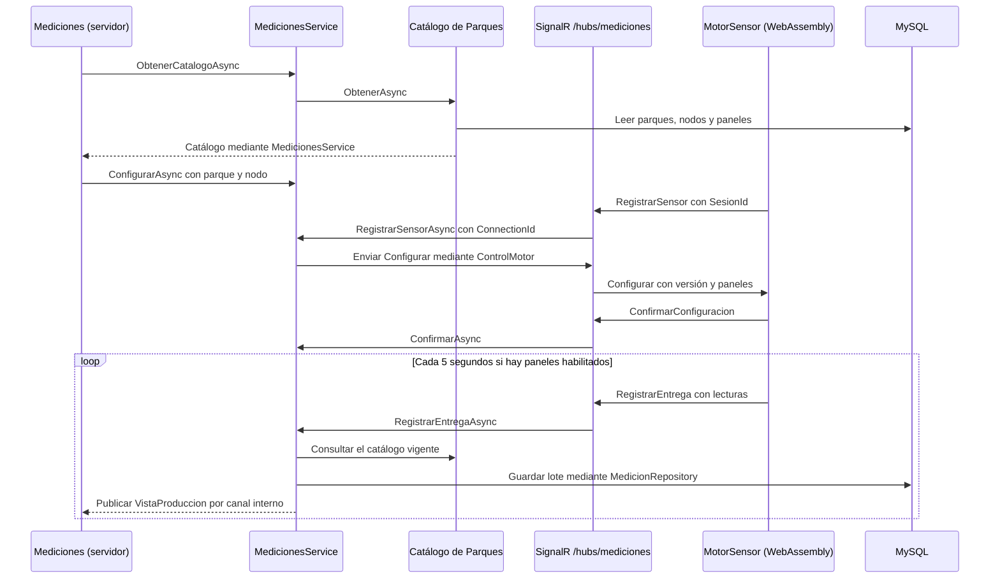

# Cómo funcionan las mediciones en tiempo real en SolarUY

La pantalla **Ver producción** (`/admin/mediciones`) obtiene de Parques los nodos y paneles configurados. El simulador genera lecturas en el navegador, las envía al servidor por SignalR y la gráfica se actualiza después de que el servidor guarda las lecturas en MySQL.

## 1. Qué corre en cada lugar

| Dónde | Componente | Responsabilidad |
| --- | --- | --- |
| Servidor | [ProduccionHost.razor](../SolarUy/Components/Pages/ProduccionHost.razor) | Abre la sesión de producción y comparte su `SesionId` con la pantalla y el motor. |
| Servidor | [Mediciones.razor](../SolarUy/Components/Pages/Mediciones.razor) y [su código C#](../SolarUy/Components/Pages/Mediciones.razor.cs) | Ejecutan la interfaz en Interactive Server. Cargan los selectores, solicitan la conexión a un nodo y actualizan la gráfica. |
| Navegador | [MotorSensor.razor](../Sensor/Components/MotorSensor.razor) | Se ejecuta en Interactive WebAssembly e inicia el cliente SignalR del simulador. |
| Servidor | [MedicionesService.cs](../SolarUy/Backend/Modulos/Mediciones/Aplicacion/Implementaciones/MedicionesService.cs) | Coordina el catálogo, la configuración del motor, la validación y el guardado. |

El navegador tiene dos conexiones con funciones distintas. El **circuito SignalR de Blazor** transporta los eventos de la interfaz y los cambios de renderizado. El **hub de la aplicación** (`/hubs/mediciones`) transporta las órdenes al motor WebAssembly y las lecturas que este devuelve. Entre el componente Interactive Server y los servicios de aplicación hay llamadas C# dentro del servidor.

## 2. Cómo carga la pantalla los parques, nodos y paneles

1. Al entrar con rol `ADMIN`, `ProduccionHost.OnInitializedAsync` obtiene la identidad autenticada y llama a `MedicionesService.CrearSesion`. La sesión queda en memoria del servidor, asociada al usuario. El host pasa el mismo identificador a `Mediciones` y `MotorSensor`, ambos con prerenderizado desactivado.
2. `Mediciones.OnInitializedAsync` empieza a escuchar cambios mediante `Servicio.Observar` y después ejecuta `CargarCatalogoAsync`. Escucha primero porque la carga puede iniciar automáticamente la conexión.
3. `MedicionesService.ObtenerCatalogoAsync` valida el acceso y llama al contrato local `ICatalogoProduccion` del módulo Parques. [CatalogoProduccionService.cs](../SolarUy/Backend/Modulos/Parques/Aplicacion/Implementaciones/CatalogoProduccionService.cs) obtiene los datos con `ParqueRepositorio.ListarAsync`, `NodoRepositorio.ListarTodosAsync` y `PanelRepositorio.ListarAsync`. Los repositorios consultan MySQL mediante EF Core y [ParquesDbContext](../SolarUy/Backend/Infraestructura/Persistencia/ParquesDbContext.cs).
4. Parques arma el árbol `ParqueProduccion → NodoProduccion → PanelProduccion`, ordenado por ID. Excluye los nodos sin paneles y los parques que se quedan sin nodos disponibles. Los paneles deshabilitados permanecen en el catálogo con su estado, junto con datos como potencia actual, orientación e ID.
5. La pantalla aplica automáticamente el primer parque y nodo disponibles en la carga inicial. Para cambiar después de parque o nodo, elegí la selección y pulsá **Conectar**. Elegir un panel del nodo activo filtra la vista. El motor se configura para el nodo completo y genera para todos sus paneles habilitados.

## 3. Cómo arranca el motor y se confirma la conexión

### Seguir las llamadas en el código

Cada paso indica el archivo y la línea. Si tu visor Markdown abre el archivo al principio, usá el número de línea indicado. Los mensajes SignalR se enlazan por nombre. Para seguirlos en el editor, buscá el texto entre comillas y saltá al receptor indicado.

| Paso | Dónde empezar y adónde saltar |
| --- | --- |
| 1. Abrir la conexión | [MotorSensor.razor, línea 8](../Sensor/Components/MotorSensor.razor#L8) ejecuta `OnAfterRenderAsync` y llama a `ConectarSensorAsync`. En la línea 16 llama a `Cliente.IniciarAsync`. Seguí en [MedicionesCliente.cs, línea 16](../Sensor/Servicios/MedicionesCliente.cs#L16). En las líneas 54 y 55 abre la conexión y envía `"RegistrarSensor"`. |
| 2. Registrar el motor | El nombre `"RegistrarSensor"` lleva a [MedicionesHub.cs, línea 16](../SolarUy/Backend/Modulos/Mediciones/Interfaz/SignalR/MedicionesHub.cs#L16). El hub pasa la identidad y el ID de conexión a [MedicionesService.cs, línea 154](../SolarUy/Backend/Modulos/Mediciones/Aplicacion/Implementaciones/MedicionesService.cs#L154). Buscá `sesion.Conexion = conexion` en la línea 163. |
| 3. Elegir qué nodo medir | En paralelo, [Mediciones.razor.cs, línea 115](../SolarUy/Components/Pages/Mediciones.razor.cs#L115) llama a [`MedicionesService.ConfigurarAsync`, línea 59](../SolarUy/Backend/Modulos/Mediciones/Aplicacion/Implementaciones/MedicionesService.cs#L59). Ahí se guarda la selección en `sesion.Configuracion`. Tanto este método como el del paso 2 llaman a [`EnviarConfiguracionAsync`, línea 114](../SolarUy/Backend/Modulos/Mediciones/Aplicacion/Implementaciones/MedicionesService.cs#L114), que espera a tener selección y conexión. |
| 4. Mandar la orden al navegador | [ControlMotor.cs, línea 18](../SolarUy/Backend/Modulos/Mediciones/Infraestructura/SignalR/ControlMotor.cs#L18) envía `"Configurar"`. El receptor está en [MedicionesCliente.cs, línea 23](../Sensor/Servicios/MedicionesCliente.cs#L23), donde el cliente llama a [`SimulacionMedicionesService.AplicarAsync`](../Sensor/Servicios/SimulacionMedicionesService.cs#L14). Ahí arranca el ciclo de generación. |
| 5. Confirmar y actualizar la pantalla | [MedicionesCliente.cs, línea 66](../Sensor/Servicios/MedicionesCliente.cs#L66) envía `"ConfirmarConfiguracion"`. Seguí por [MedicionesHub.cs, línea 18](../SolarUy/Backend/Modulos/Mediciones/Interfaz/SignalR/MedicionesHub.cs#L18) y [`MedicionesService.ConfirmarAsync`, línea 171](../SolarUy/Backend/Modulos/Mediciones/Aplicacion/Implementaciones/MedicionesService.cs#L171). La pantalla recibe el estado confirmado y completa la espera en [Mediciones.razor.cs, línea 101](../SolarUy/Components/Pages/Mediciones.razor.cs#L101). El límite de 20 segundos está en la línea 120. |

### Qué ocurre en cada salto

`MotorSensor.OnAfterRenderAsync` inicia [MedicionesCliente.cs](../Sensor/Servicios/MedicionesCliente.cs) en el primer render del componente WebAssembly. El cliente registra los mensajes entrantes, abre el hub y llama a `RegistrarSensor(SesionId)`. El [hub](../SolarUy/Backend/Modulos/Mediciones/Interfaz/SignalR/MedicionesHub.cs) requiere rol `ADMIN` y pasa al servicio el usuario autenticado y el `ConnectionId`. El servicio comprueba que la sesión pertenezca al usuario y vincula la conexión a ella.

La selección y el registro del motor pueden llegar en cualquier orden. `ConfigurarAsync` guarda la configuración del nodo en la sesión. Si el motor aún no está conectado, la configuración queda disponible para cuando se registre. Si se registra primero, recibe la configuración cuando la pantalla elige el nodo.

[ControlMotor.cs](../SolarUy/Backend/Modulos/Mediciones/Infraestructura/SignalR/ControlMotor.cs) envía **`Configurar`** a ese `ConnectionId`, con el ID de sesión, la versión, el parque, el nodo y la lista de paneles con potencia, habilitación y revisión de estado. El simulador aplica la orden y el cliente invoca **`ConfirmarConfiguracion`** con la versión y el estado aplicado. `MedicionesService.ConfirmarAsync` verifica que coincidan la conexión, la versión y los paneles vigentes. La pantalla espera hasta 20 segundos la confirmación de la selección.



## 4. Cómo se genera, envía y guarda una lectura

1. [SimulacionMedicionesService.cs](../Sensor/Servicios/SimulacionMedicionesService.cs) inicia un temporizador de **5 segundos** al aplicar la configuración. En cada ciclo genera un valor aleatorio en watts a partir de `Random.Shared.NextDouble() * PotenciaActual` por panel habilitado. Las lecturas de un mismo ciclo comparten la fecha UTC. Si todos los paneles están deshabilitados, el ciclo no envía entregas.
2. Cada `EntregaMotorDto` contiene un `EntregaId` nuevo, el ID de sesión, la versión, los IDs de parque y nodo y las lecturas. Cada lectura lleva ID de panel, revisión de estado, valor y fecha. `MedicionesCliente` envía el lote con `InvokeAsync("RegistrarEntrega", ...)`. El hub traduce el mensaje a los tipos de aplicación y llama a `MedicionesService.RegistrarEntregaAsync`.
3. El servicio comprueba el usuario, la conexión, la selección confirmada y su versión. Ignora una entrega que ya figura como guardada en la sesión y consulta el catálogo vigente para verificar que los paneles sigan perteneciendo al nodo. Omite lecturas de paneles deshabilitados o con revisión vencida. Valida, entre otras condiciones, que los valores estén dentro de la potencia actual y las fechas estén en orden.
4. El servicio crea una entidad `Medicion` por lectura válida. [MedicionRepository.AgregarEntregaAsync](../SolarUy/Backend/Modulos/Mediciones/Infraestructura/Repositorios/MedicionRepository.cs) crea un contexto con `IDbContextFactory<MedicionesDbContext>`, agrega el lote con `AddRange` y llama una vez a `SaveChangesAsync`. La tabla **`Mediciones`** conserva el ID de la medición, los IDs de parque, nodo y panel, el valor generado y la fecha UTC.
5. Tras el guardado, el servicio registra el ID de la entrega en la sesión, actualiza las últimas lecturas por panel, agrega la muestra a la serie y escribe una `VistaProduccion` en el canal interno de la sesión. `Mediciones.LeerActualizacionesAsync` consume el canal, aplica la vista en el contexto de Blazor con `InvokeAsync` y llama a `StateHasChanged`. El circuito de Blazor envía el cambio de la interfaz al navegador.

Si el envío falla, el simulador genera una muestra nueva en el próximo ciclo. Si falla el guardado, la pantalla recibe el estado de error y conserva los datos previamente confirmados.

## 5. Cambios de estado y cierre

| Acción | Qué ocurre |
| --- | --- |
| Cambiar de nodo y pulsar **Conectar** | El servidor crea una nueva versión de la selección y limpia la serie en memoria del nodo anterior. El motor detiene el ciclo anterior antes de generar para el otro nodo. La versión permite detectar mensajes atrasados. |
| Habilitar o deshabilitar un panel desde Producción | `MedicionesService.CambiarHabilitacionAsync` guarda el cambio mediante `ICatalogoProduccion` y `PanelRepositorio`. Después actualiza la revisión del panel y envía `CambiarHabilitacionPanel` a los motores conectados que usan ese nodo. El motor aplica el estado y lo confirma. |
| Perder la conexión | El motor pausa la generación. Al reconectar, vuelve a invocar `RegistrarSensor` y el servidor vuelve a enviar la configuración vigente. El cliente también envía `Latido` cada 30 segundos, incluso cuando no hay paneles habilitados. |
| Salir de Producción | La pantalla cancela su lectura del canal y cierra la sesión. El servidor completa el canal y, si el motor sigue conectado, envía `Detener`. El componente WebAssembly libera su cliente y su ciclo. Las mediciones guardadas quedan en MySQL. |

## 6. Cómo seguir el flujo en ejecución

1. Prepará las credenciales y el usuario de Keycloak con rol `ADMIN` según el [README](../Readme.md). Desde la raíz del repositorio, iniciá los servicios y la aplicación.

   ```powershell
   docker compose up -d mysql keycloak
   dotnet run --project SolarUy/SolarUy.csproj --launch-profile http
   ```

2. Entrá en [Producción](http://localhost:5058/admin/mediciones) con un parque que tenga al menos un nodo con un panel habilitado. La pantalla selecciona el primer nodo disponible al cargar. Esperá la confirmación del motor y observá cómo la gráfica incorpora nuevas muestras.
3. Para seguir el código con puntos de interrupción en el servidor, usá este orden:

   | Qué querés ver | Punto de interrupción |
   | --- | --- |
   | Qué parques, nodos y paneles llegan a la pantalla | `CatalogoProduccionService.ObtenerAsync` |
   | Dónde se vincula el motor con la página | `MedicionesHub.RegistrarSensor` |
   | Cuándo el motor confirma la selección | `MedicionesService.ConfirmarAsync` |
   | Qué trae cada lote del navegador | `MedicionesHub.RegistrarEntrega` |
   | Cuándo se confirma la escritura | `MedicionRepository.AgregarEntregaAsync`, en `SaveChangesAsync` |
   | Cómo llega la muestra a la gráfica | `Mediciones.ActualizarVista` |

El punto de entrada de la configuración es [SolarUy/Program.cs](../SolarUy/Program.cs). Ahí se registran los servicios, las fábricas de contextos, los modos interactivos y el endpoint `/hubs/mediciones`. [Sensor/Program.cs](../Sensor/Program.cs) registra el cliente SignalR y el simulador que se instancian en el navegador.
