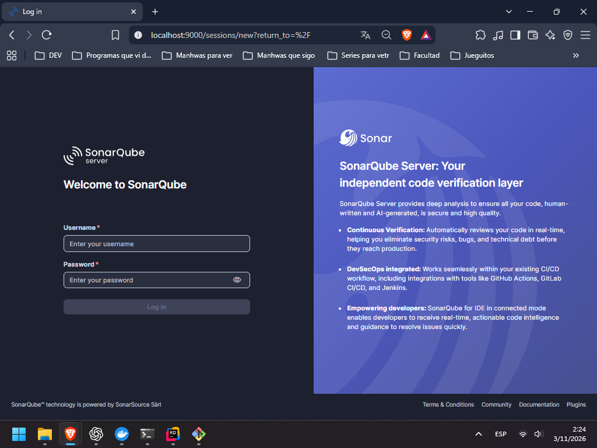
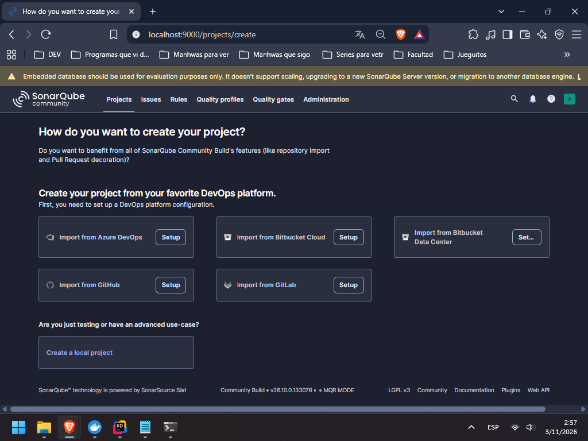
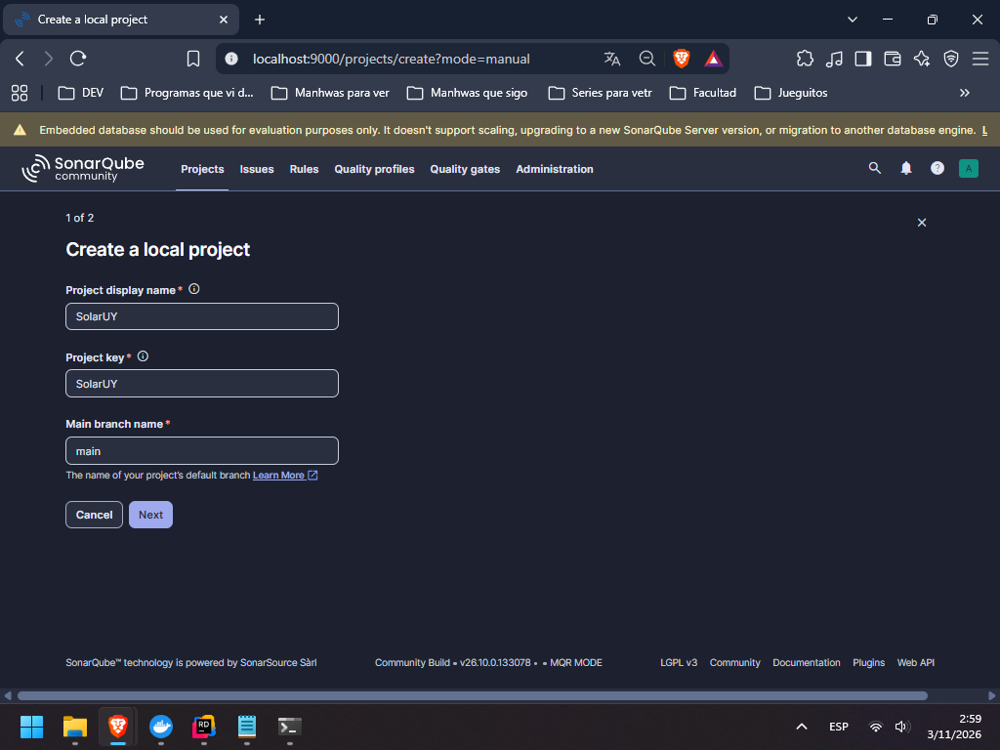
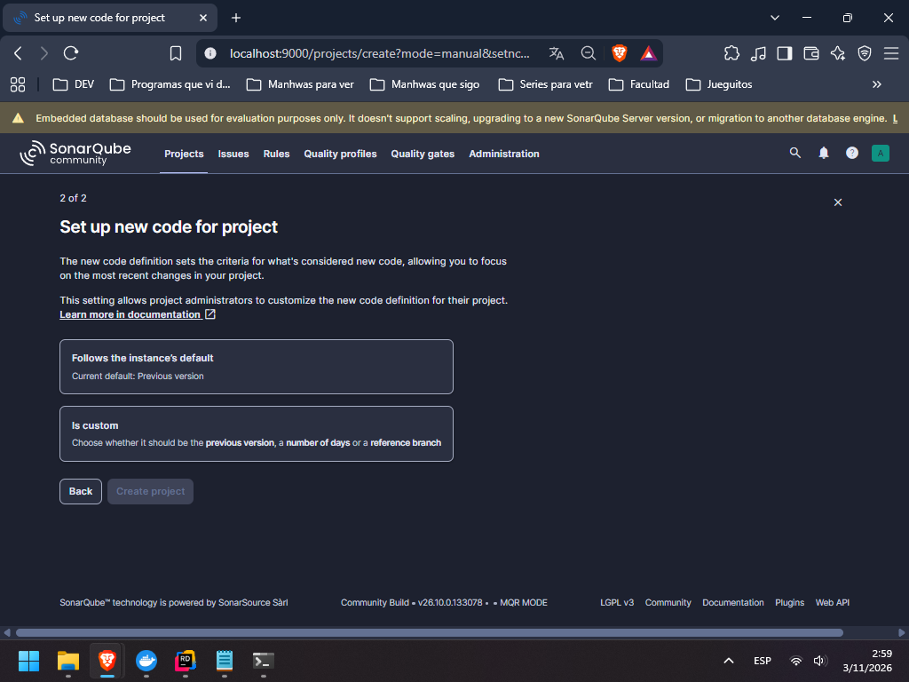
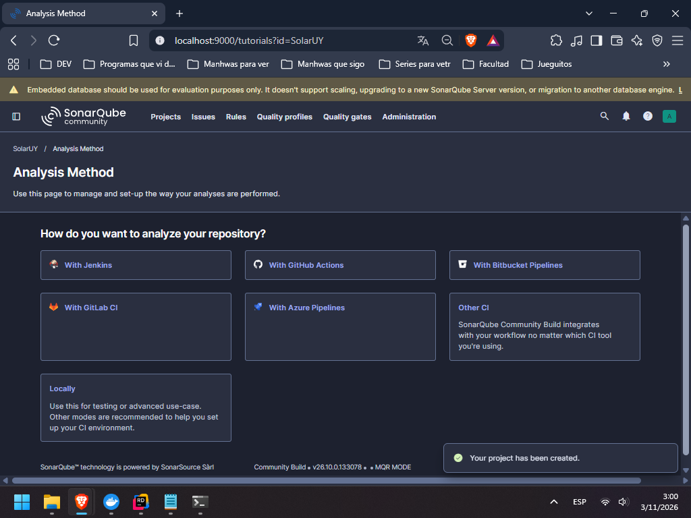
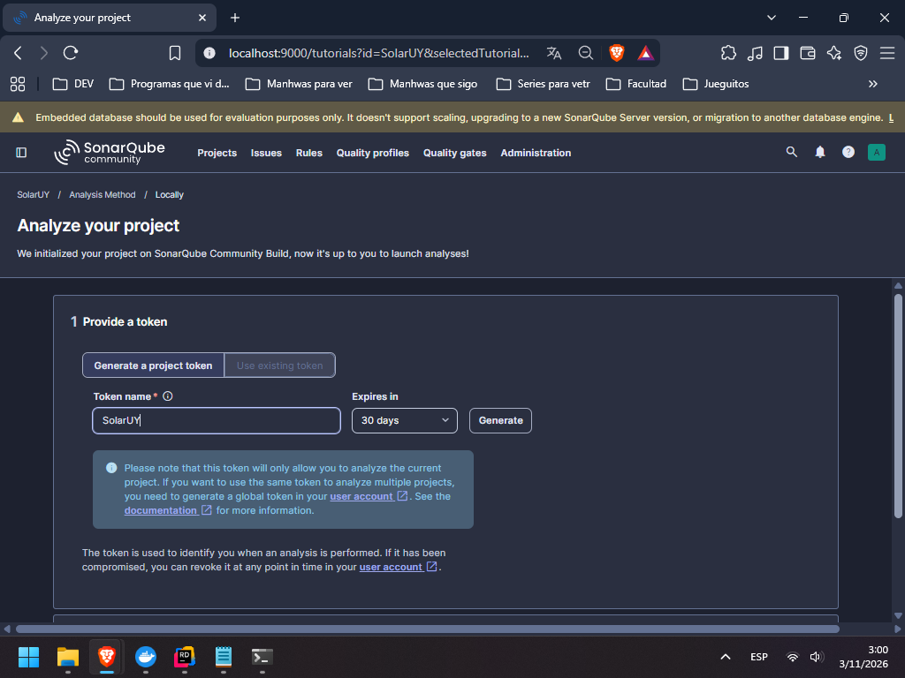
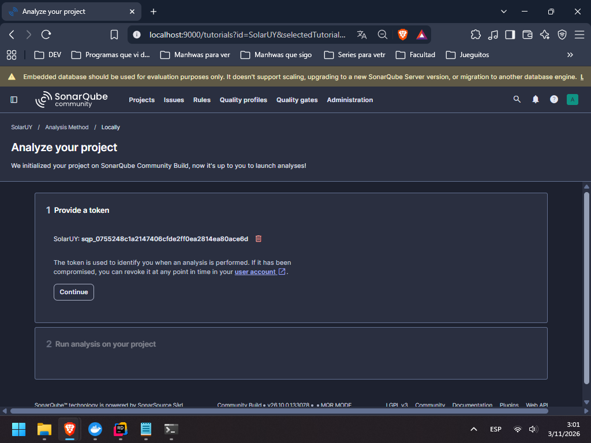
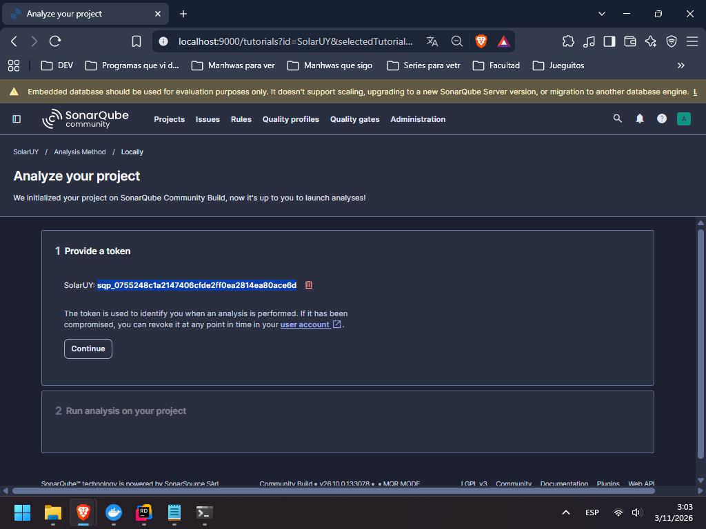

# SonarQube: guía rápida

[← Volver al README del proyecto](../Readme.md)

Usar **PowerShell en la raíz del repositorio**, con Docker Desktop iniciado
en modo contenedores Linux y el SDK .NET 10 instalado. Detener SolarUy en Rider
antes de analizar para evitar archivos bloqueados.

## 1. Iniciar SonarQube

```powershell
docker compose up -d sonarqube
```

Abrir http://localhost:9000 y esperar a que aparezca la consola. El primer arranque
puede tardar unos minutos. Si se usa Docker Engine en WSL, ejecutar solo este
comando de Docker en Ubuntu; los comandos dotnet se ejecutan en Windows.

## 2. Preparar el acceso (una sola vez por instalación)

Entrar con `admin` / `admin` y cambiar la contraseña inicial. Para desarrollo
local, el equipo puede usar opcionalmente `Solar_Uy1234`.



Si no existe el proyecto, elegir **Create Project → Create a local project**.



Completar nombre y clave con **SolarUY**, dejar la rama `main` y pulsar **Next**.



Elegir **Follows the instance's default** y pulsar **Create project**.



Elegir **Locally** para analizar desde la computadora.



Ingresar un nombre para el token, elegir su vencimiento y pulsar **Generate**.



Copiar el token generado y guardarlo fuera del repositorio: se pedirá al analizar.



Seleccionar y copiar el valor del token, como se muestra en esta captura de ejemplo.



Puede reutilizarse hasta que caduque o se revoque; la contraseña de acceso no
sirve como token. Si el proyecto ya existe, también se puede generar desde
**My Account → Security**, eligiendo **Project Analysis Token** y **SolarUY**.

La preparación en la consola termina aquí. Continuar con el bloque del paso 3;
no hace falta seguir el tutorial de instalación global que ofrece SonarQube.

El token del primer análisis de instalación fue revocado: generar uno propio.

## 3. Ejecutar un análisis nuevo

Cuando la consola esté disponible, copiar el bloque completo en PowerShell.
La terminal pedirá el token; pegarlo y presionar Enter.

```powershell
dotnet tool restore
if ($LASTEXITCODE -ne 0) { throw 'No se pudo restaurar el scanner.' }

$clave = Read-Host 'Pegá el token de SonarQube' -AsSecureString
$token = [System.Net.NetworkCredential]::new('', $clave).Password
try {
    dotnet sonarscanner begin /k:SolarUY /d:sonar.host.url=http://localhost:9000 /d:sonar.token="$token" /d:sonar.scanner.scanAll=false /d:sonar.qualitygate.wait=true /d:sonar.qualitygate.timeout=300
    if ($LASTEXITCODE -ne 0) { throw 'Falló el inicio del análisis.' }

    dotnet build SolarUy.sln --no-incremental
    if ($LASTEXITCODE -ne 0) { throw 'Falló la compilación.' }

    dotnet test SolarUyPruebas/Unitarias/Parques/SolarUyParquesPruebas.csproj --no-build
    if ($LASTEXITCODE -ne 0) { throw 'Fallaron las pruebas.' }

    dotnet sonarscanner end /d:sonar.token="$token"
    if ($LASTEXITCODE -ne 0) { throw 'Revisá la salida y el Quality Gate en la consola.' }
} finally {
    $token = $null
    $clave = $null
}
```

## 4. Ver el resultado y terminar

Abrir [SolarUY en SonarQube](http://localhost:9000/dashboard?id=SolarUY).
En **Issues**, abrir cada problema para ver el archivo y la explicación.
**Quality Gate** indica si el análisis cumple las condiciones de calidad.
El panel se actualiza al ejecutar un análisis, no al guardar código en Rider.
La cobertura puede figurar en 0 % porque todavía no se envían reportes de cobertura.

Para detener SonarQube conservando sus datos:

```powershell
docker compose stop sonarqube
```

Si no arranca, consultar `docker compose logs --tail 50 sonarqube`.
No usar `docker compose down -v` para detenerlo: borra los datos de SonarQube,
MySQL y Keycloak. Esta instalación de SonarQube es para evaluación local.
