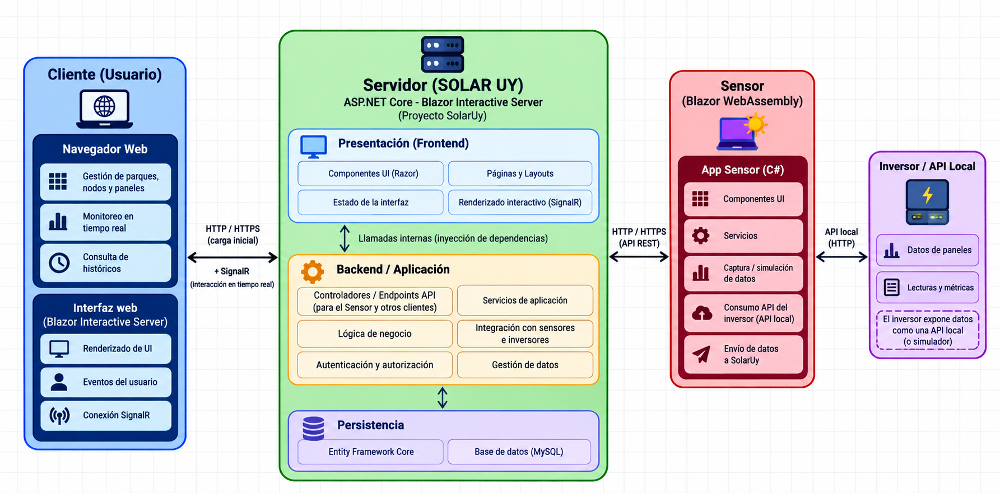

# SolarUY

Prueba de concepto académica del Taller .NET para la gestión de parques solares,
sus paneles, mantenimiento y mediciones. La solución adopta un monolito modular
con los módulos Usuarios, Parques, Tareas y Mediciones.

## Estado actual

- **Home:** presentación en `/` y `/Home`, con tarjetas informativas e imagen
  ilustrativa del futuro dashboard.
- **Panel administrativo:** vista provisional en `/admin`, con barra lateral
  adaptable, resumen sin datos, accesos deshabilitados, actividad vacía y gráfica
  de ejemplo. Los dos botones «Ingresar al panel» de Home abren esta página;
  Inicio y el logo del panel permiten regresar a Home.
- **Dominio inicial:** clases Usuario, UsuarioTecnico y UsuarioAdmin en Usuarios;
  Parque, Nodo y Panel en Parques; enumerados en `Dominio/Enums/` de sus módulos.
  Medicion y TareaMantenimiento todavía no están implementadas.
- **Sensor:** proyecto separado con páginas de plantilla, sin captura de datos
  ni comunicación con SolarUy implementadas.

El panel no requiere autenticación en esta etapa. No hay gestión persistente,
mediciones reales, monitoreo, reportes ni integración con hardware. Las cifras
incluidas en las imágenes son ilustrativas.

## Proyectos y tecnologías

| Proyecto real | Tecnología | Función actual |
| --- | --- | --- |
| [SolarUy](SolarUy/SolarUy.csproj) | ASP.NET Core Blazor Web App, .NET 10 | Aplicación principal con páginas Razor, layouts, recursos y estructura modular del backend. |
| [Sensor](Sensor/Sensor.csproj) | Blazor WebAssembly Standalone, .NET 8 | Base de una aplicación independiente destinada al sensor/simulador; conserva el contenido de plantilla. |

SolarUy tiene habilitado **Interactive Server**. La interactividad configurada
se ejecuta en el servidor y utiliza SignalR para comunicarse con el navegador.
Home y PanelAdmin son vistas de presentación sin operaciones de negocio.
Bootstrap y CSS definen la apariencia; los íconos son imágenes locales.

La presentación y el backend de SolarUy pertenecen al mismo proyecto. Los
componentes llamarán a los servicios de aplicación mediante C# e inyección de
dependencias dentro del proceso; no hay proyectos separados de frontend y API
para esta comunicación interna.

Los módulos separan responsabilidades de Dominio, Aplicación e Infraestructura,
con carpetas de Interfaz para contratos de comunicación. Gran parte de esta
estructura está reservada para trabajo futuro. Las reglas vigentes están en
[AGENTS.md](AGENTS.md) y [.agents/Reglas/](.agents/Reglas/).

## Organización del repositorio

```text
SolarUy.sln
SolarUy/
    Components/
        Pages/                 Home, PanelAdmin y páginas de plantilla
        Layout/                HomeLayout, MainLayout y NavMenu
    Backend/
        Modulos/
            Usuarios/
            Parques/
            Tareas/
            Mediciones/
        Infraestructura/
    wwwroot/                   CSS, Bootstrap, imágenes e íconos
Sensor/                        Aplicación WebAssembly independiente
Funcionalidades/               Requisitos, diseños, tareas y verificaciones
Docs/
    Diagramas/                 Diagramas exportados como imágenes
    Iconos/                    Recursos originales de íconos
    IA/                        Prompts e instrucciones históricas
.agents/                       Reglas y flujo de trabajo del agente
AGENTS.md                      Instrucciones vigentes del proyecto
```

Los documentos del desarrollo asistido por IA se agrupan en
[Funcionalidades/](Funcionalidades/), por funcionalidad, con `requirements.md`,
`specs.md` y `tasks.md`. Los prompts e instrucciones anteriores están en
[Docs/IA/](Docs/IA/); son material histórico y pueden describir una arquitectura
anterior. Las instrucciones activas permanecen en AGENTS.md y .agents.

Docs también contiene la letra del taller, el boceto de casos de uso y las
imágenes de referencia. Las carpetas vacías no equivalen a funcionalidades
implementadas y Git no las conserva si no contienen archivos.

## Diagramas de diseño

### Arquitectura prevista



El diagrama muestra la dirección del diseño, no el estado completo de la
implementación. La aplicación principal corresponde a `SolarUy/` y el proyecto
WebAssembly a `Sensor/`. Entity Framework Core, MySQL, los endpoints externos,
la integración con el inversor y la autenticación dibujados siguen pendientes.
El transporte entre Sensor y SolarUy también requiere definición e implementación.

Las próximas versiones del diagrama deben incorporar explícitamente el proveedor
externo de identidad compatible con OpenID Connect, el componente de consultas
mediante lenguaje natural y la estrategia de despliegue para alta disponibilidad,
requisitos de la letra todavía pendientes. MySQL aparece como propuesta del
esquema, no como proveedor configurado.

### Modelo de clases propuesto


Este esquema es una referencia de trabajo. Las clases implementadas se enumeran
en «Estado actual»; el modelo completo, sus relaciones y las automatizaciones
anotadas en el dibujo todavía no están implementados. Los ajustes acordados,
como Imagen de tipo string para guardar una ruta relativa, están documentados
en [ModeloDominioInicial](Funcionalidades/ModeloDominioInicial/specs.md).

## Ejecución local

Requisitos: SDK de .NET 10 para SolarUy y SDK de .NET 8 para Sensor, además de
acceso a NuGet durante la restauración inicial de paquetes.

Desde la raíz del repositorio:

```powershell
dotnet build SolarUy.sln
dotnet run --project SolarUy/SolarUy.csproj --launch-profile http
```

Abrir la dirección indicada en la terminal y visitar `/` o `/admin`. No es
necesario iniciar Sensor para utilizar estas pantallas ni configurar una base
de datos. El perfil HTTPS requiere un certificado de desarrollo confiable.

## Verificación y pendientes

La compilación comprueba que los proyectos pueden construirse. Todavía no hay
proyectos de pruebas con xUnit ni reglas automatizadas con ArchUnitNET.
SonarQube no está configurado en el repositorio; existe una
[guía de configuración](Docs/ReadmeSonarQube.md). Ejecutar `dotnet test` no realiza
un análisis de SonarQube.

Los resultados y limitaciones de cada tarea se registran en sus documentos:
[Home](Funcionalidades/PaginaPrincipal/tasks.md) y
[panel administrativo](Funcionalidades/PanelAdministrativo/tasks.md).
En el entorno de verificación se detectaron errores locales de Data Protection
con claves DPAPI al abrir las páginas interactivas de plantilla `/counter` y
`/weather`; esa revisión sigue pendiente. Las pantallas Home y panel son
provisionales y no incluyen esas operaciones interactivas.
