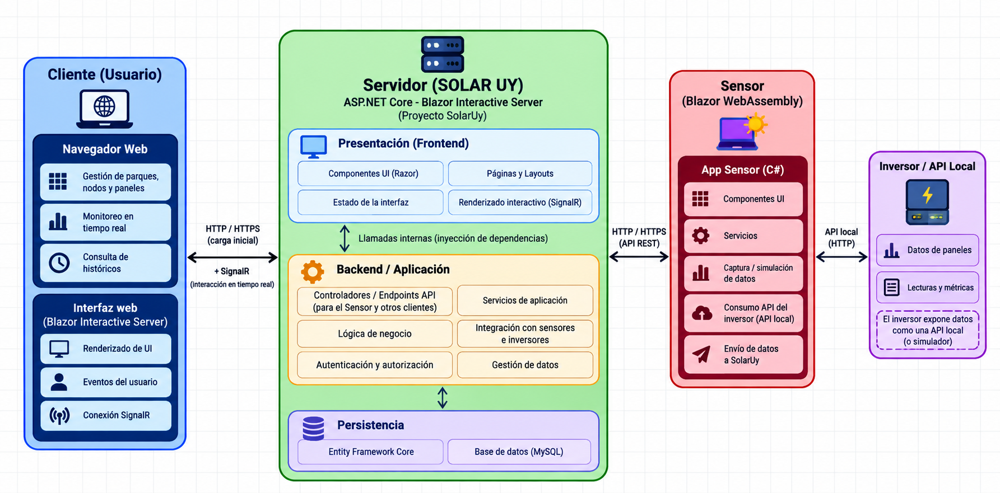
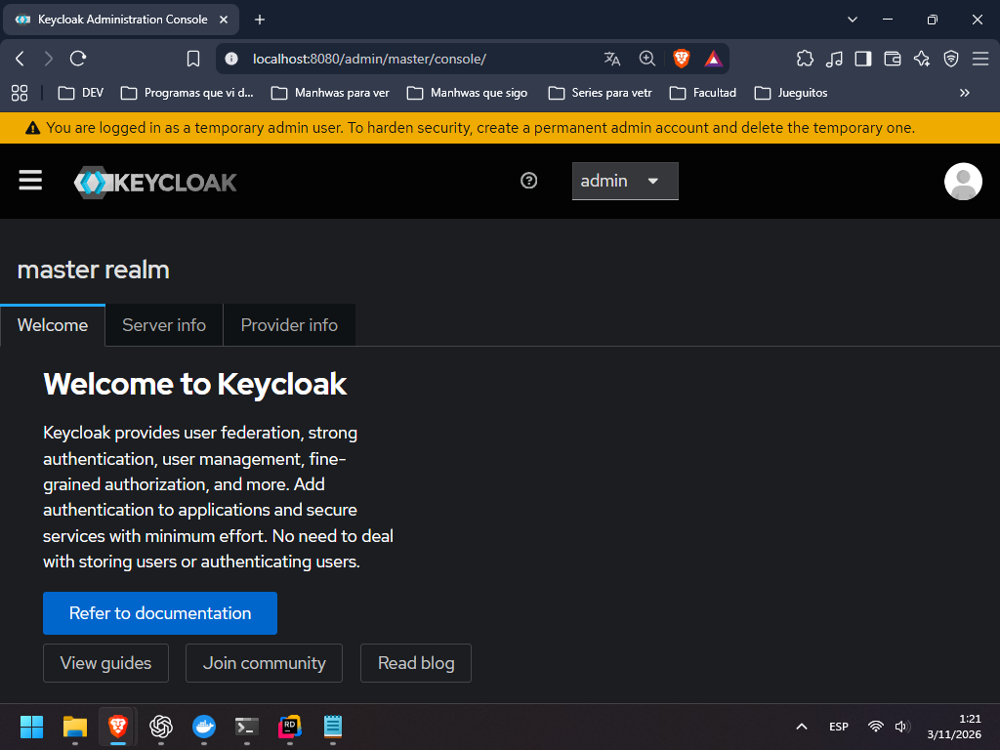
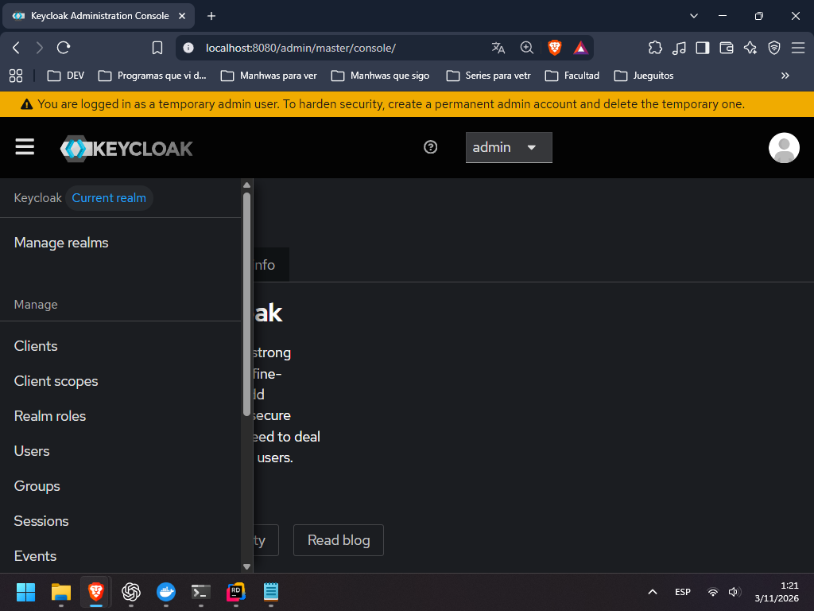
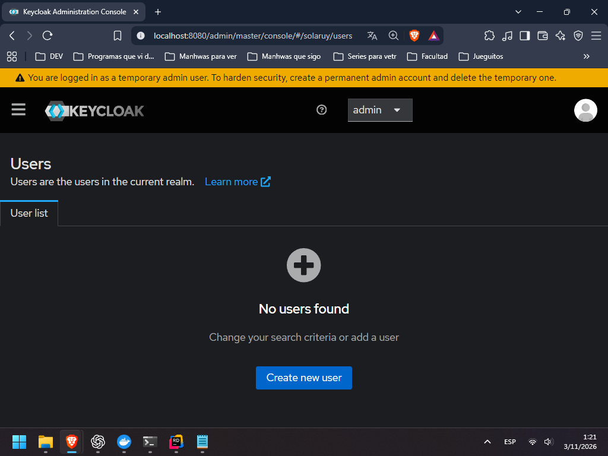
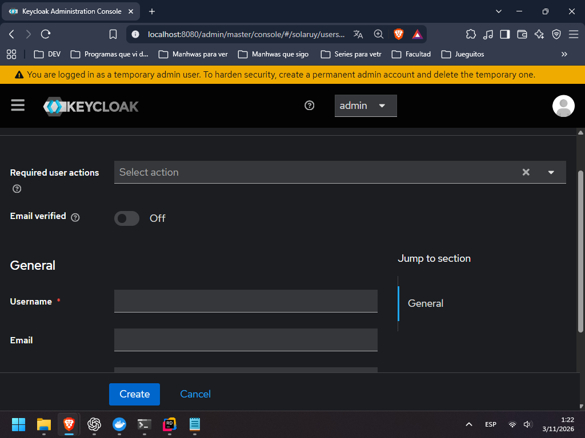
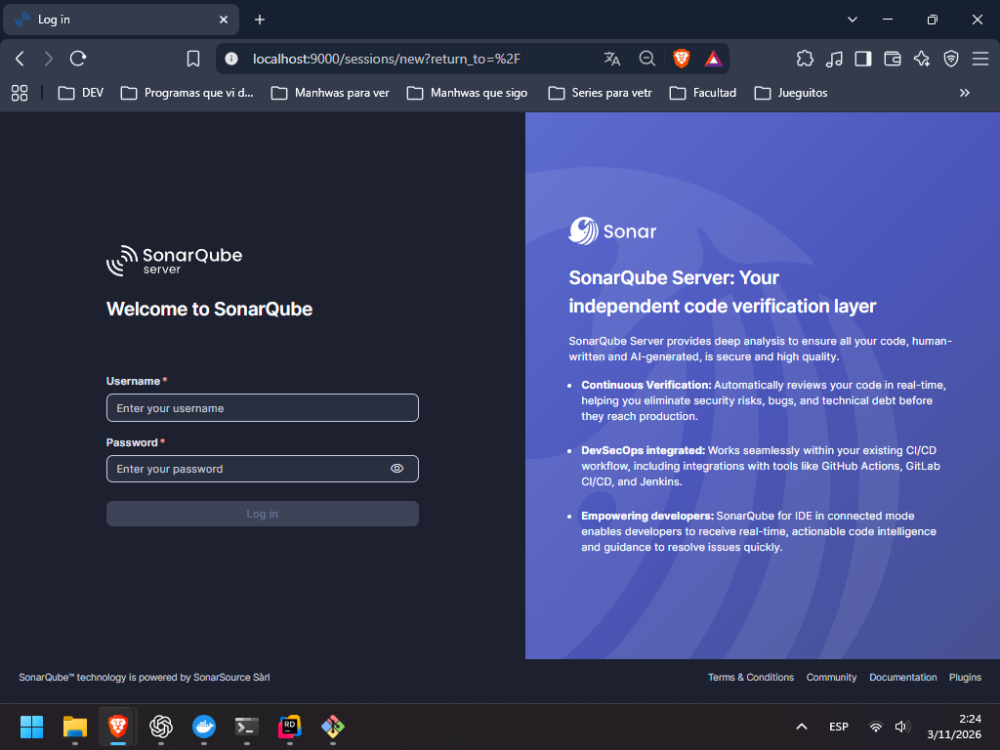

# SolarUY

Prueba de concepto académica del Taller .NET para la gestión de parques solares,
sus paneles, mantenimiento y mediciones. La solución adopta un monolito modular
con los módulos Usuarios, Parques, Tareas y Mediciones.

## Estado actual

- **Home:** presentación en `/` y `/Home`, con tarjetas informativas e imagen
  ilustrativa del futuro dashboard.
- **Panel administrativo:** vista en `/admin` protegida por autenticación,
  con consulta de parques y secciones visuales todavía provisionales.
  Los dos botones «Ingresar al panel» de Home abren esta página;
  Inicio y el logo del panel permiten regresar a Home.
- **Dominio inicial:** clases Usuario, UsuarioTecnico y UsuarioAdmin en Usuarios;
  Parque, Nodo y Panel en Parques; enumerados en `Dominio/Enums/` de sus módulos.
  Medicion y TareaMantenimiento todavía no están implementadas.
- **Sensor:** proyecto separado con páginas de plantilla, sin captura de datos
  ni comunicación con SolarUy implementadas.

El panel requiere autenticación mediante Keycloak y la gestión de parques,
nodos y paneles utiliza MySQL mediante Entity Framework Core. No hay mediciones
reales, monitoreo, reportes ni integración con hardware. Las cifras incluidas
en las imágenes son ilustrativas.

## Proyectos y tecnologías

| Proyecto real | Tecnología | Función actual |
| --- | --- | --- |
| [SolarUy](SolarUy/SolarUy.csproj) | ASP.NET Core Blazor Web App, .NET 10 | Aplicación principal con páginas Razor, layouts, recursos y estructura modular del backend. |
| [Sensor](Sensor/Sensor.csproj) | Blazor WebAssembly, .NET 10 | Base destinada al sensor/simulador, referenciada por SolarUy; conserva contenido de plantilla. |

SolarUy tiene habilitado **Interactive Server**. La interactividad configurada
se ejecuta en el servidor y utiliza SignalR para comunicarse con el navegador.
Home presenta el proyecto; PanelAdmin consulta los parques mediante servicios de aplicación.
Bootstrap y CSS definen la apariencia; los íconos son imágenes locales.

La presentación y el backend de SolarUy pertenecen al mismo proyecto. Los
componentes llamarán a los servicios de aplicación mediante C# e inyección de
dependencias dentro del proceso; no hay proyectos separados de frontend y API
para esta comunicación interna.

Los módulos separan responsabilidades de Dominio, Aplicación e Infraestructura,
con carpetas de Interfaz para contratos de comunicación. Gran parte de esta
estructura está reservada para trabajo futuro. Las reglas vigentes están en
[AGENTS.md](AGENTS.md) y [.agents/Reglas/](.agents/Reglas/).

## Organización del repositorio

```text
SolarUy.sln
SolarUy/
    Components/
        Pages/                 Home, PanelAdmin y páginas de plantilla
        Layout/                HomeLayout, MainLayout y NavMenu
    Backend/
        Modulos/
            Usuarios/
            Parques/
            Tareas/
            Mediciones/
        Infraestructura/
    wwwroot/                   CSS, Bootstrap, imágenes e íconos
Sensor/                        Aplicación WebAssembly independiente
Funcionalidades/               Requisitos, diseños, tareas y verificaciones
Docs/
    Diagramas/                 Diagramas exportados como imágenes
    Iconos/                    Recursos originales de íconos
    IA/                        Prompts e instrucciones históricas
.agents/                       Reglas y flujo de trabajo del agente
AGENTS.md                      Instrucciones vigentes del proyecto
```

Los documentos del desarrollo asistido por IA se agrupan en
[Funcionalidades/](Funcionalidades/), por funcionalidad, con `requirements.md`,
`specs.md` y `tasks.md`. Los prompts e instrucciones anteriores están en
[Docs/IA/](Docs/IA/); son material histórico y pueden describir una arquitectura
anterior. Las instrucciones activas permanecen en AGENTS.md y .agents.

Docs también contiene la letra del taller, el boceto de casos de uso y las
imágenes de referencia. Las carpetas vacías no equivalen a funcionalidades
implementadas y Git no las conserva si no contienen archivos.

## Diagramas de diseño

### Arquitectura prevista



El diagrama muestra la dirección del diseño, no el estado completo de la
implementación. La aplicación principal corresponde a `SolarUy/` y el proyecto
WebAssembly a `Sensor/`. Entity Framework Core, MySQL y la autenticación con
Keycloak ya están configurados. Los endpoints externos y la integración con
el inversor siguen pendientes.
El transporte entre Sensor y SolarUy también requiere definición e implementación.

Las próximas versiones del diagrama deben incorporar explícitamente el proveedor
externo de identidad Keycloak, compatible con OpenID Connect. El componente de
consultas mediante lenguaje natural y la estrategia de despliegue para alta
disponibilidad siguen pendientes.

### Modelo de clases propuesto


Este esquema es una referencia de trabajo. Las clases implementadas se enumeran
en «Estado actual»; el modelo completo, sus relaciones y las automatizaciones
anotadas en el dibujo todavía no están implementados. Los ajustes acordados,
como Imagen de tipo string para guardar una ruta relativa, están documentados
en [ModeloDominioInicial](Funcionalidades/ModeloDominioInicial/specs.md).

## Ejecución local con Docker

Se necesita el SDK .NET 10, acceso a NuGet y Docker Desktop iniciado en modo
contenedores Linux. Los comandos se ejecutan desde la raíz del repositorio en
PowerShell. Como alternativa, con Docker Engine en Ubuntu/WSL 2, ejecutar allí
los comandos de Docker y mantener los comandos dotnet en Windows.

[compose.yaml](compose.yaml) configura tres servicios independientes:

| Servicio | Función | Puerto local |
| --- | --- | --- |
| [MySQL](#mysql-base-de-datos) | Base de datos de parques, nodos y paneles. | 3306 |
| [Keycloak](#keycloak-usuarios-e-inicio-de-sesión) | Proveedor de identidad: usuarios, autenticación y roles. | 8080 |
| [SonarQube](#sonarqube-calidad-del-código) | Análisis de calidad del código. | 9000 |

Docker descarga las imágenes necesarias. SolarUy se ejecuta desde Rider o
mediante dotnet, fuera de los contenedores. No se necesita iniciar Sensor por
separado. SonarQube se utiliza al analizar código; no es necesario para usar SolarUy.

### Preparación compartida: credenciales locales

Si no existe `.env`, ejecutar el asistente de Windows:

```powershell
powershell -NoProfile -ExecutionPolicy Bypass -File .\Scripts\Configurar-EntornoLocal.ps1
```

El asistente pide las contraseñas en texto visible, ofrece conservar o cambiar
los usuarios predeterminados y crea `.env` y la conexión de User Secrets con las
mismas credenciales de MySQL. Si ya existe `.env`, avisa y espera una tecla antes
de salir sin modificarlo. Para repetir la preparación, eliminarlo manualmente;
para conservarlo, seguir la configuración manual indicada abajo.

Como alternativa, copiar el ejemplo y editar sus contraseñas antes de iniciar
los contenedores:

```powershell
Copy-Item .env.example .env
```

`.env` configura Docker Compose y está excluido de Git. SolarUy no lo lee
automáticamente; utiliza User Secrets o variables de entorno.

### MySQL: base de datos

MySQL debe estar disponible antes de iniciar SolarUy: en Development, la
aplicación aplica las migraciones al arrancar.

```powershell
docker compose up -d mysql
docker compose ps -a mysql
docker compose logs --tail 50 mysql
```

Esperar a que aparezca como `healthy`. Si se preparó `.env` manualmente,
configurar también la conexión de la aplicación en Windows:

```powershell
dotnet user-secrets set "ConnectionStrings:SolarUy" "Server=localhost;Port=3306;Database=solaruy;User=solaruy_app;Password=REEMPLAZAR_PASSWORD;" --project SolarUy/SolarUy.csproj
```

Reemplazar `REEMPLAZAR_PASSWORD` por `MYSQL_PASSWORD` y ajustar `User` si se
cambió `MYSQL_USER`. El asistente ya realiza este paso. También se admite la
variable de entorno `ConnectionStrings__SolarUy` en el proceso de SolarUy.

Para abrir la consola de MySQL:

```powershell
docker compose exec mysql mysql -uroot -p
```

Usar la contraseña root con la que se inicializó el volumen. Cambiar las
contraseñas de `.env` no actualiza los usuarios de una base ya inicializada.

### Keycloak: usuarios e inicio de sesión

Keycloak permite iniciar sesión en las páginas protegidas de SolarUy.

```powershell
docker compose up -d keycloak
docker compose logs --tail 50 keycloak
```

Compose ejecuta también un contenedor auxiliar BusyBox para preparar permisos;
su finalización exitosa es esperada. El realm `solaruy` y el cliente OIDC se
importan desde [solaruy-realm.json](SolarUyKeycloak/solaruy-realm.json).
Docker inicia Keycloak con `start-dev`, su modo de desarrollo local.

Después de definir las credenciales administrativas locales y levantar los
contenedores, abrir la consola de Keycloak en `http://localhost:8080/admin/`
(también se puede llegar desde `http://localhost:8080/`). Iniciar sesión con
el usuario `KEYCLOAK_BOOTSTRAP_ADMIN` y la contraseña
`KEYCLOAK_BOOTSTRAP_PASSWORD` definidos en `.env`.



Seleccionar el realm `solaruy` y abrir **Users** en la barra lateral.



Elegir **Create new user** y completar el formulario.





**Required user actions** permite exigir acciones que el usuario deberá
completar para iniciar sesión, como cambiar la contraseña o configurar otro
método de autenticación. En esta configuración se deja vacío porque solo se
pide usuario y contraseña.

Después de crear el usuario, abrir **Credentials**
para asignarle una contraseña; desactivar **Temporary** si no se quiere exigir
un cambio de contraseña en el primer inicio de sesión. Para permitirle
operaciones restringidas a administradores de SolarUy, asignarle el rol de
realm `ADMIN` desde **Role mapping**. Finalmente, iniciar sesión en SolarUy
con este usuario nuevo. El administrador de Keycloak no es automáticamente
un usuario de SolarUy.

### SonarQube: calidad del código

SonarQube analiza posibles errores, seguridad, mantenibilidad y duplicación.
El scanner de Windows envía los resultados al servidor del contenedor.

```powershell
docker compose up -d sonarqube
docker compose logs --tail 50 sonarqube
```

La [guía rápida de uso de SonarQube](Docs/ReadmeSonarQube.md) contiene los pasos
para crear un token y un bloque de comandos para repetir el análisis. El panel
muestra el último análisis enviado; no se actualiza al guardar un archivo.
Esta instalación está destinada a evaluación local.

Con SonarQube iniciado, abrir `http://localhost:9000`. En una instalación nueva,
las credenciales de fábrica son **usuario `admin` y contraseña `admin`**.
Después de ingresar, establecer una contraseña propia cuando la consola lo
solicite. Esta cuenta es independiente de las credenciales de `.env` y Keycloak.
Para las instalaciones locales del equipo, se sugiere opcionalmente la contraseña
`Solar_Uy1234`, que cumple los requisitos mostrados por SonarQube.



### Iniciar SolarUy

Con MySQL healthy y Keycloak operativo, ejecutar en Windows:

```powershell
dotnet tool restore
dotnet build SolarUy.sln
dotnet run --project SolarUy/SolarUy.csproj --launch-profile http
```

También se puede usar el perfil `http` de Rider. Abrir http://localhost:5058
cuando aparezca `Now listening on`. El perfil HTTPS utiliza
https://localhost:7196 y requiere un certificado de desarrollo confiable.
La configuración local de Keycloak está en
[appsettings.Development.json](SolarUy/appsettings.Development.json).

### Comandos útiles y problemas de arranque

| Comando | Uso |
| --- | --- |
| `docker compose up -d mysql keycloak` | Iniciar los servicios necesarios para SolarUy. |
| `docker compose up -d` | Iniciar todos los servicios, incluido SonarQube. |
| `docker compose ps -a` | Consultar el estado de los contenedores. |
| `docker compose stop` | Detener los servicios conservando los datos. |
| `docker compose stop sonarqube` | Detener únicamente SonarQube. |

Los volúmenes conservan los datos de MySQL, Keycloak y SonarQube entre arranques.
`docker compose down -v` elimina esos volúmenes y sus datos.

- **Falta ConnectionStrings:SolarUy:** configurar User Secrets según la sección de MySQL.
- **Error de conexión a MySQL:** comprobar estado healthy y puerto 3306.
- **Access denied en MySQL:** verificar las credenciales del usuario existente;
  cambiar `.env` no cambia la contraseña guardada en MySQL.
- **Error al iniciar sesión:** comprobar Keycloak en el puerto 8080 y utilizar
  un usuario del realm `solaruy`, distinto de la cuenta administrativa de Keycloak.
- **SonarQube no responde:** esperar el arranque y consultar sus registros.
- **ERR_CONNECTION_REFUSED en SolarUy:** revisar la salida de Rider o dotnet;
  la aplicación puede haberse cerrado antes de escuchar.

## Verificación y pendientes

La compilación comprueba que los proyectos pueden construirse. Las pruebas xUnit
de Parques están en `SolarUyPruebas/Unitarias/Parques/SolarUyParquesPruebas.csproj`.
No hay reglas automatizadas con ArchUnitNET identificadas en esta integración.
Ejecutar `dotnet test` por sí solo no realiza un análisis de SonarQube.

Los resultados y limitaciones de cada tarea se registran en sus documentos:
[Home](Funcionalidades/PaginaPrincipal/tasks.md) y
[panel administrativo](Funcionalidades/PanelAdministrativo/tasks.md).
En el entorno de verificación se detectaron errores locales de Data Protection
con claves DPAPI al abrir las páginas interactivas de plantilla `/counter` y
`/weather`; esa revisión sigue pendiente. Las pantallas Home y panel son
provisionales y no incluyen esas operaciones interactivas.

## ¿Cómo utilizamos la IA?

Durante este Sprint estuvimos probando utilizar ChatGPT Desktop en lugar del CLI,
principalmente por la comodidad que ofrece para adjuntar imágenes y documentos.
Esto resulta especialmente útil con archivos PDF, ya que la extensión de Rider
no permite enviarlos directamente, siendo necesario dejarlos en una carpeta e
indicarle al agente dónde encontrarlos.

Por otro lado, para consultas más generales seguimos utilizando el chat
convencional, ya sea desde la propia aplicación de escritorio o desde la versión
web, dado que cuenta con un contexto más personalizado sobre nuestras
preferencias, como el estilo, formato y nivel de detalle de las respuestas.
