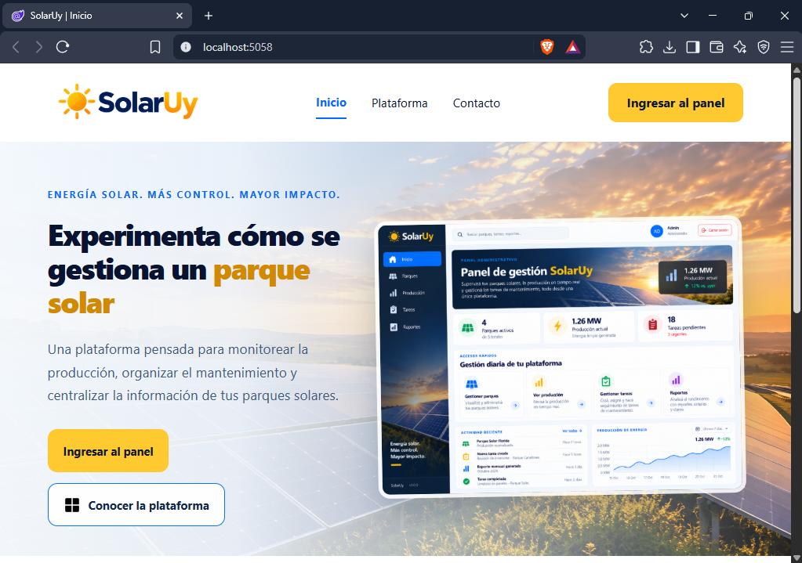
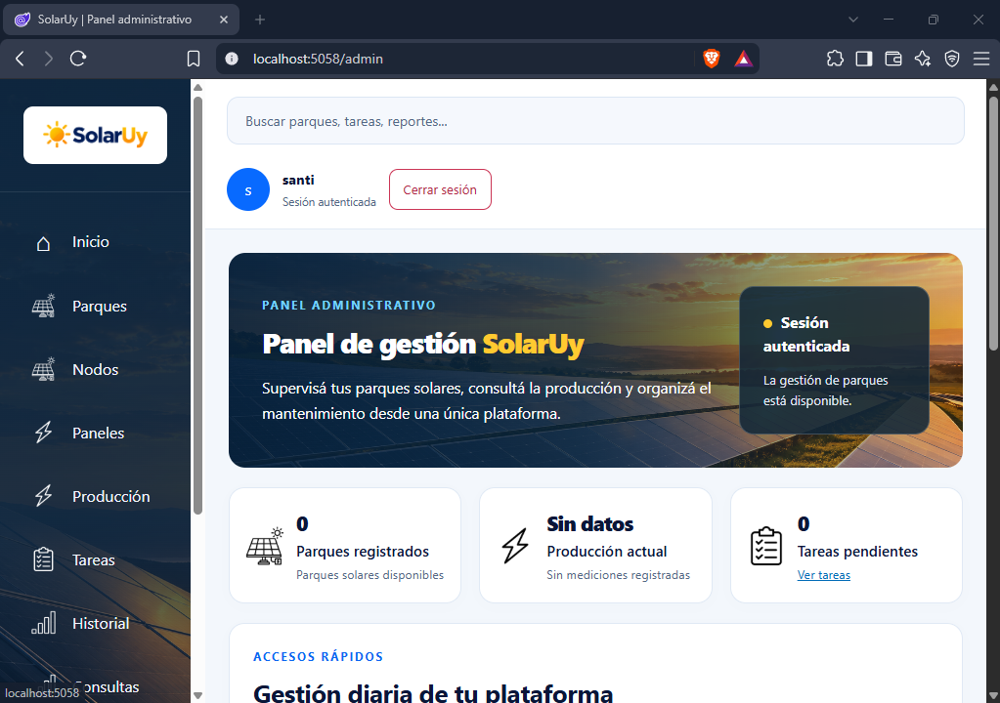

# SolarUY

Prueba de concepto académica del Taller .NET para gestionar parques solares,
sus nodos y paneles, tareas de mantenimiento y mediciones. La aplicación utiliza
Blazor Web App con Interactive Server y un monolito modular. La generación se
representa mediante un simulador; no existe conexión con un inversor físico.

La página de inicio presenta la plataforma y permite ingresar al panel protegido.
La imagen de dashboard que aparece dentro de la landing es ilustrativa.



El panel administrativo reúne accesos a la gestión y un resumen de parques y
tareas. Algunas secciones visuales siguen siendo provisionales; la gráfica
ilustrativa del panel no representa mediciones reales.



La [documentación de arquitectura](Docs/Arquitectura.md) reúne la estructura del
repositorio y los diagramas de referencia. Algunas descripciones de estado de
ese documento corresponden a etapas anteriores del proyecto.

## 1. Prerrequisitos

- SDK **.NET 10**, necesario para restaurar dependencias, compilar y ejecutar.
- **Docker Desktop** iniciado y configurado para contenedores Linux, con Docker Compose.
- **PowerShell** para los comandos y el asistente de configuración en Windows.
- Una copia del repositorio y conexión a Internet para descargar imágenes y paquetes NuGet.
- Puertos locales **3306**, **8080**, **9000** y **5058** disponibles.

Si falta alguna herramienta, consultar la [guía de instalación de prerrequisitos](Docs/Prerequisitos.md).
Rider es opcional: la aplicación también se ejecuta desde la terminal.
No se necesita instalar MySQL ni Keycloak directamente en Windows.

## 2. Preparar y levantar el proyecto

Abrir PowerShell en la **raíz del repositorio**, donde están `SolarUy.sln`,
`compose.yaml` y la carpeta `Scripts`. Iniciar Docker Desktop.

En una instalación nueva, **primero configurar las credenciales y después
ejecutar Docker Compose**. El archivo Compose exige esas variables y no puede
arrancar los servicios sin ellas. En los siguientes arranques, si `.env` y
User Secrets ya están configurados, pasar directamente al arranque de contenedores.

### Configuración asistida de credenciales

Si todavía no existe `.env`, ejecutar:

```powershell
powershell -NoProfile -ExecutionPolicy Bypass -File .\Scripts\Configurar-EntornoLocal.ps1
```

También se puede abrir `Scripts/Configurar-EntornoLocal.cmd` desde el Explorador.
El asistente pide usuarios y contraseñas, muestra las contraseñas mientras se
escriben y solicita confirmación antes de guardar. Su resultado es:

| Destino | Qué configura | Quién lo utiliza |
| --- | --- | --- |
| `.env` | Usuario y contraseñas de MySQL, y credenciales del administrador inicial de Keycloak. | Docker Compose al inicializar los servicios. |
| User Secrets de .NET | `ConnectionStrings:SolarUy`, con la conexión del usuario MySQL elegido. | SolarUY al ejecutarse en Development. |

`.env` está excluido de Git y SolarUY no lo lee automáticamente. User Secrets
guarda la configuración fuera del repositorio; el proyecto ya incluye su
`UserSecretsId`. La contraseña administrativa de Keycloak queda en `.env`,
no en User Secrets. El asistente tampoco crea el usuario que ingresará a SolarUY.

Si `.env` ya existe, el asistente se detiene sin modificarlo ni actualizar
User Secrets. Conservar las credenciales existentes y completar los pasos
manuales que falten. Cambiar `.env` no restablece las contraseñas de servicios
cuyos volúmenes ya fueron inicializados.

### Alternativa manual

Si `.env` no existe, crearlo desde el ejemplo:

```powershell
Copy-Item .env.example .env
```

Editar `.env` y reemplazar todos los valores `replace-with-*` por contraseñas
locales propias. Contiene estas variables:

```dotenv
MYSQL_ROOT_PASSWORD=REEMPLAZAR_CLAVE_ROOT
MYSQL_USER=solaruy_app
MYSQL_PASSWORD=REEMPLAZAR_CLAVE_MYSQL
KEYCLOAK_BOOTSTRAP_ADMIN=admin
KEYCLOAK_BOOTSTRAP_PASSWORD=REEMPLAZAR_CLAVE_KEYCLOAK
```

Configurar la conexión de SolarUY con el mismo usuario y contraseña de MySQL:

```powershell
dotnet user-secrets set "ConnectionStrings:SolarUy" "Server=localhost;Port=3306;Database=solaruy;User=solaruy_app;Password=REEMPLAZAR_CLAVE_MYSQL;" --project SolarUy/SolarUy.csproj
```

Reemplazar el valor de ejemplo y ajustar `User` si se cambió `MYSQL_USER`.
Como alternativa, la aplicación admite la variable de entorno
`ConnectionStrings__SolarUy` en su proceso. No subir contraseñas ni `.env` a Git.

### Iniciar los contenedores

Con las credenciales preparadas, ejecutar desde la raíz:

```powershell
docker compose up -d
docker compose ps -a
```

| Servicio | Función | Dirección local |
| --- | --- | --- |
| MySQL | Persistencia de la aplicación. | `localhost:3306` |
| Keycloak | Usuarios, inicio de sesión y roles. | [Consola de administración](http://localhost:8080/admin/) |
| SonarQube | Análisis de calidad durante el desarrollo. | [Consola de SonarQube](http://localhost:9000) |

Esperar a que MySQL aparezca como **healthy** y que Keycloak termine de iniciar.
`Running` indica que el contenedor está en ejecución, pero el servicio puede
seguir inicializándose. Revisar sus registros si es necesario:

```powershell
docker compose logs --tail 50 mysql
docker compose logs --tail 50 keycloak
```

El contenedor auxiliar `preparar-volumen-keycloak` debe terminar con **Exited (0)**:
solo prepara los permisos del volumen. Keycloak importa el realm `solaruy` y
el cliente desde [solaruy-realm.json](SolarUyKeycloak/solaruy-realm.json).
Las cuentas de usuarios de la aplicación se crean después, desde su consola.

El puerto de Keycloak se publica en `127.0.0.1` para el acceso local por IPv4.
`compose.yaml` incluye comentada la alternativa para acceder desde otros equipos;
se debe mantener una sola opción activa y volver a ejecutar `docker compose up -d keycloak`.

SonarQube no es necesario para utilizar SolarUY. Para iniciar solo los servicios
necesarios para la aplicación, se puede usar `docker compose up -d mysql keycloak`.

### Ejecutar SolarUY

Con MySQL y Keycloak disponibles:

```powershell
dotnet restore SolarUy.sln
dotnet build SolarUy.sln
dotnet run --project SolarUy/SolarUy.csproj --launch-profile http
```

También se puede abrir la solución en Rider y ejecutar el perfil `http` de
SolarUy. No iniciar Sensor por separado. En Development, SolarUY aplica las
migraciones de MySQL al arrancar. Cuando aparezca `Now listening on`, abrir
[la aplicación](http://localhost:5058).

Antes de ingresar al panel por primera vez, completar el tutorial de Keycloak
de la sección siguiente. Si el usuario ya está preparado, pulsar **Ingresar al panel**.

### Consultar las tablas con MySQL Workbench — opcional

MySQL Workbench permite explorar la base desde una interfaz gráfica y no es
un requisito de SolarUY. La configuración prevista es una conexión TCP/IP a
`127.0.0.1`, puerto `3306`, con `MYSQL_USER`, su contraseña y el esquema `solaruy`.
Las tablas se crean cuando la aplicación aplica las migraciones.
**La prueba práctica de esta conexión con Workbench está pendiente.**

Para consultar MySQL desde la terminal ya se dispone de:

```powershell
docker compose exec mysql mysql -uroot -p
```

Ingresar la contraseña root con la que se inicializó el volumen.

### Detener y volver a iniciar

`docker compose stop` detiene los servicios y conserva los datos.
Para volver a iniciarlos, ejecutar `docker compose up -d` y luego SolarUY.
Los volúmenes conservan bases y usuarios entre arranques; `docker compose down -v`
elimina esos datos y no es un paso de la configuración habitual.

## 3. Configurar el usuario de Keycloak

SolarUY utiliza Keycloak como proveedor de identidad mediante OpenID Connect:
Keycloak autentica al usuario y comunica sus roles; la aplicación valida los
permisos de las operaciones protegidas. La cuenta administrativa de la consola
de Keycloak y la cuenta del usuario de SolarUY son distintas.

Seguir el [tutorial ilustrado de Keycloak](Docs/ReadmeKeycloak.md) para crear
un usuario en el realm `solaruy`, asignarle contraseña y el rol `ADMIN`, e
ingresar al panel. Incluye la solución para una sesión que conserva permisos
anteriores a la asignación del rol.

## 4. SonarQube durante el desarrollo

Se utilizó SonarQube durante el desarrollo asistido por IA para revisar posibles
errores, seguridad, mantenibilidad y duplicación. Es una herramienta de análisis
de código; complementa la compilación, las pruebas y la revisión humana.

La [guía de SonarQube](Docs/ReadmeSonarQube.md) explica cómo preparar su acceso,
generar un token, ejecutar el scanner y consultar el Quality Gate. El panel
muestra el último análisis enviado: no se actualiza al guardar código.
`dotnet test` por sí solo no ejecuta SonarQube.

Las pruebas xUnit existentes se ejecutan desde la raíz con:

```powershell
dotnet test SolarUyPruebas/Unitarias/Parques/SolarUyParquesPruebas.csproj
```

## 5. ¿Cómo programamos con IA?

Trabajamos con un arnés de IA: un entorno que permite al agente leer el
repositorio, proponer cambios, editar archivos y ejecutar verificaciones bajo
las instrucciones de [AGENTS.md](AGENTS.md) y las [reglas del proyecto](.agents/Reglas/).
Para organizar cada funcionalidad utilizamos `requirements.md` para definir
qué se necesita, `specs.md` para diseñar cómo resolverlo y `tasks.md` para dividir
y registrar el trabajo en [Funcionalidades/](Funcionalidades/). Revisamos los
requisitos y las propuestas, implementamos por tareas y contrastamos el resultado
con compilación, pruebas aplicables y revisiones de SonarQube. Las decisiones y
la revisión final siguen a cargo del equipo; la salida del agente no constituye
por sí sola una validación del cambio.
